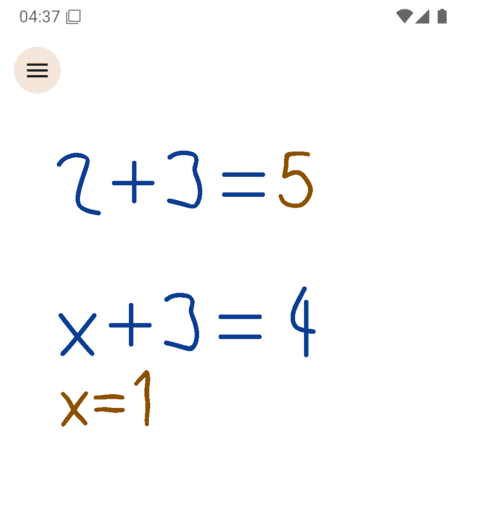
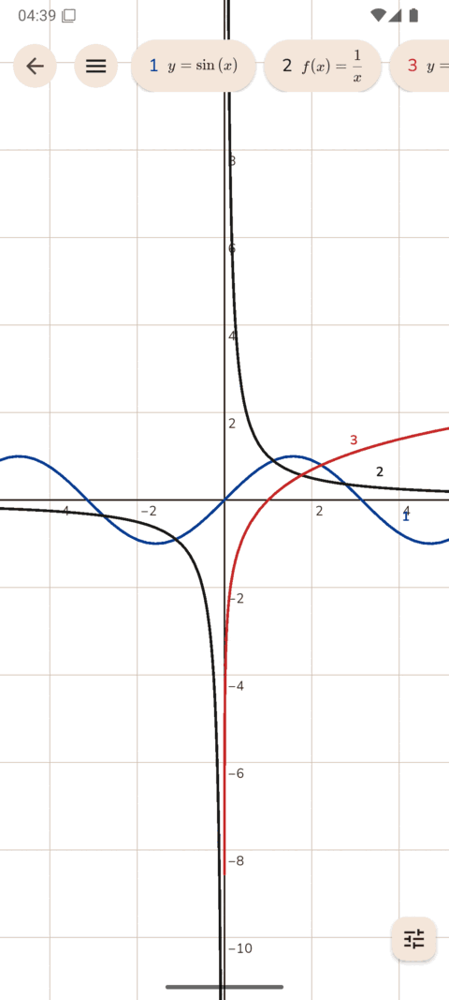
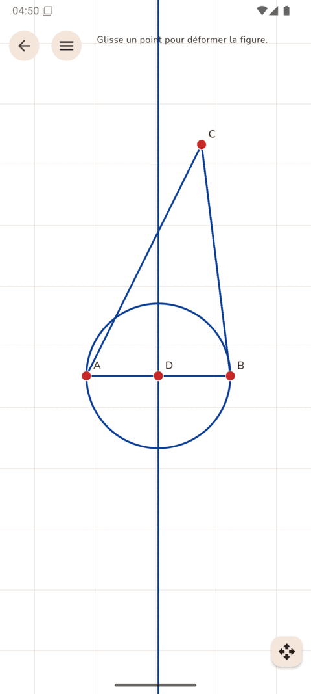

<h1 align="center">Fikajiana</h1>

<p align="center"><b>On écrit des maths à la main, l'app calcule et répond à la main.</b><br>
Calcul exact, graphes et géométrie, sur une feuille qui prend tout l'écran.<br>
Android, téléphone et tablette. <b>Libre</b>, sans compte, sans pub, et <b>hors ligne</b> une fois le modèle téléchargé.</p>

<p align="center">
  <a href="https://github.com/raantss18/Fikajiana/releases/latest/download/fikajiana-arm64-v8a.apk"><b>⬇️ Télécharger pour Android</b></a>
  ·
  <a href="https://github.com/raantss18/Fikajiana/releases/latest">Notes de la dernière version</a>
</p>

> **Langues / Languages :** **Français** · [English summary](#english)

<p align="center">
  
  
  
</p>

## Ce qu'on peut faire

- **Écrire** au stylet ou au doigt, sur une feuille blanche, un cahier ou un tableau noir, avec des stylos de couleur et une gomme, sur une page sans bord.
- **Calculer** : écris `2+3=` et le résultat s'écrit à la main après le signe égal. Écris `x+3=4` et la solution s'écrit dessous. Fractions, racines, équations, inéquations, systèmes, dérivées, intégrales, limites, sommes, matrices, nombres complexes, suites.
- **Basculer** entre valeur exacte et approchée, degrés et radians.
- **Tracer** : écris `f(x)=x^2`, touche Tracer à côté, et la courbe s'affiche. Cela marche aussi avec `x^2+y^2=4`, `(\cos(t),\sin(t))` ou `r=1+\cos(\theta)`. Glisser, pincer, plusieurs courbes, tableau de valeurs, un toucher lit les coordonnées d'un point.
- **Exporter** : la feuille entière, le graphe ou la figure, en image PNG ou en PDF, à l'endroit de ton choix.
- **Construire** : 40 outils nommés, de la parallèle à la conique par cinq points : polygones, arcs, tangentes, symétries, rotations, homothéties, mesures, curseurs, lieux. Déplace un point : toute la figure suit. L'outil Relation dit ce qui lie deux objets.
- **Retrouver** : le Menu crée une nouvelle feuille, un graphe ou une figure, et l'Historique les garde tous, sur l'appareil.
- **Effacer d'un geste** : gribouille sur ce que tu as écrit ; un `1/3` en ligne se range en fraction, avec tes propres traits.
- **Corriger** : touche un résultat pour voir ce qui a été lu et le changer, ou saisis au clavier.
- **Dessiner net** : maintiens le stylet à la fin d'un trait pour obtenir une ligne, un cercle, un triangle ou un rectangle.

Tout tient dans deux boutons, Menu et Outils. Le reste de l'écran est à toi.

## Installer

1. [**Télécharge l'APK**](https://github.com/raantss18/Fikajiana/releases/latest/download/fikajiana-arm64-v8a.apk) (Android 7 ou plus, 64 bits), ouvre-le et autorise l'installation si Android le demande.
2. Pour lire l'écriture : Menu → Réglages → « Télécharger le modèle » (117 Mo, une seule fois). Sans lui, la saisie au clavier marche quand même.
3. Les versions suivantes s'installent depuis l'app : Réglages → rechercher une mise à jour.

## À savoir

- **La lecture se trompe encore souvent** : 37 expressions justes sur 50 dans [un essai optimiste](docs/recherche/spike-ocr.md), avec une seule personne. La lecture ne s'affiche pas : si un résultat te surprend, touche-le.
- **Pas encore là** : formes dessinées reconnues, texte et fonctions dans une figure. L'avancement est dans [`docs/TODO.md`](docs/TODO.md).
- **Vie privée** : aucun compte, aucune pub, aucune télémétrie. L'encre ne quitte l'appareil que si tu exportes vers un dossier en ligne de ton choix. Seuls le téléchargement du modèle et la recherche de mise à jour, à ta demande, utilisent le réseau.
- **Le modèle de lecture n'est pas dans l'application** : il vient de [la page de son auteur](https://huggingface.co/breezedeus/pix2text-mfr), sous licence MIT. L'origine de ses données d'entraînement n'est pas publiée ([ADR 0016](docs/adr/0016-modele-telecharge.md)).

## Pour les développeurs

Flutter (Dart), avec le moteur de calcul formel [Giac](https://xcas.univ-grenoble-alpes.fr/en.html) en C++ et la lecture par [Pix2Text-MFR](https://huggingface.co/breezedeus/pix2text-mfr) sur ONNX Runtime.

```bash
native/giac/construire.sh arm64-v8a   # le moteur, une fois
cd app && flutter pub get && flutter run
flutter analyze
```

| Je veux… | Lire |
| --- | --- |
| connaître les règles du projet | [`CLAUDE.md`](CLAUDE.md) |
| voir où on en est, et les erreurs déjà corrigées | [`docs/TODO.md`](docs/TODO.md) |
| comprendre un choix | [`docs/adr/`](docs/adr) · [`docs/recherche/`](docs/recherche) |
| comprendre la construction et le design | [`docs/architecture.md`](docs/architecture.md) · [`docs/design.md`](docs/design.md) |
| publier une version | [`docs/RELEASING.md`](docs/RELEASING.md) |
| voir ce qui a changé | [`app/CHANGELOG.md`](app/CHANGELOG.md) |

## Auteur et contact

**RANIRIAMANJAKA Antsa** — conception et développement

- E-mail : [antsa.raniriamanjaka@univ-antananarivo.mg](mailto:antsa.raniriamanjaka@univ-antananarivo.mg)
- GitHub : [github.com/raantss18](https://github.com/raantss18)

## Licences

Code sous [GPL-3.0-or-later](LICENSE) ; dépendances : [`THIRD_PARTY_LICENSES.md`](THIRD_PARTY_LICENSES.md).

---

## English

**Fikajiana** lets you write maths by hand: the app computes and answers by hand. Exact calculation, graphs and dynamic geometry on a full-screen sheet, for Android phones and tablets. Free software, no account, no ads, and offline once the model is downloaded.

- 📱 **[Download for Android](https://github.com/raantss18/Fikajiana/releases/latest/download/fikajiana-arm64-v8a.apk)** (Android 7 or later, 64-bit) · [latest release notes](https://github.com/raantss18/Fikajiana/releases/latest)
- To read handwriting: Menu → Settings → "Download the model" (117 MB, once). Keyboard entry works without it.
- **Recognition is still often wrong** (37 of 50 in [an optimistic test](docs/recherche/spike-ocr.md)): tap a result to see what was read and correct it.
- Not there yet: hand-drawn shapes, text and functions in a figure.
- **Author:** RANIRIAMANJAKA Antsa — [antsa.raniriamanjaka@univ-antananarivo.mg](mailto:antsa.raniriamanjaka@univ-antananarivo.mg). **License:** GPL-3.0-or-later.
